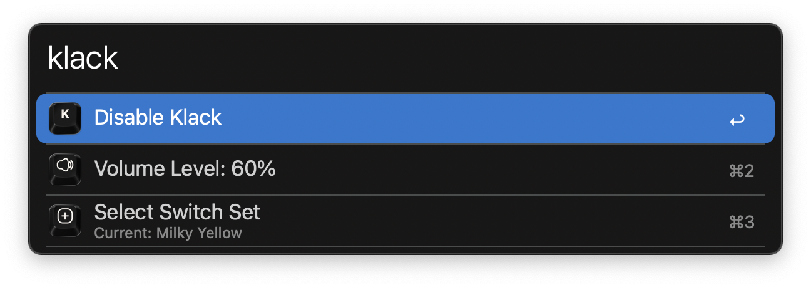
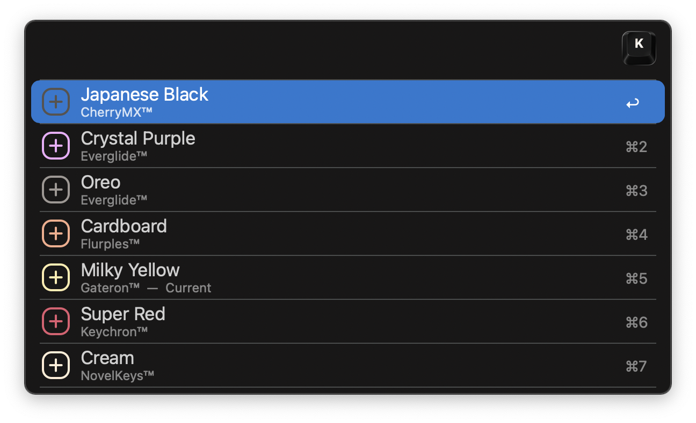

#  Klack Alfred Workflow

Control [Klack](https://tryklack.com) with Alfred

[⤓ Download the workflow](https://github.com/iAli/klack-workflow/releases/latest)

## Usage

Trigger Klack commands via the `klack` keyword.

Configure the Hotkey for faster triggering.
